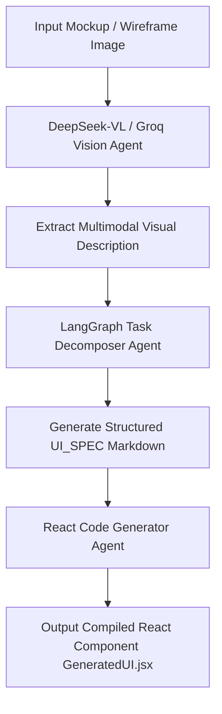

# 🤖 Omni-Architect

[](https://www.python.org/)
[](https://fastapi.tiangolo.com/)
[](https://nextjs.org/)
[](https://www.langchain.com/langgraph)
[](https://groq.com/)

> A multi-agent AI orchestration system built with Python, LangGraph, LangChain, and Groq API. Designed agent coordination logic for task decomposition, multimodal vision analysis, and parallel execution across specialized agents with ultra-low latency inference.

---

## 🌟 Key Features

- **Multi-Agent Orchestration**: State-driven task decomposition and execution workflow powered by **LangGraph** (`StateGraph`) and **LangChain**.
- **Multimodal Vision & Spec Extraction**: Integrated vision-language parsing using DeepSeek-VL and Groq LLMs to analyze design mockups/wireframes and extract structured markdown UI specifications (`## UI_SPEC`).
- **Ultra-Low Latency Inference**: High-throughput inference pipeline accelerated by Groq's LPU infrastructure.
- **Automated React/UI Code Generation**: End-to-end transformation from visual wireframes/specs to production-ready React component code (`GeneratedUI.jsx`).
- **Interactive Next.js Dashboard**: Futuristic web interface (`/web`) featuring interactive canvases, starfields, cursor glow effects, and live session specification inspection.
- **Enterprise-Grade FastAPI Backend**: Robust backend (`/backend`) featuring JWT authentication, session artifact isolation (`/specs/sessions/`), CORS protections, and configurable OpenAPI access.

---

## 🏗️ System Architecture

```text
Omni-Architect/
├── backend/                  # FastAPI service for orchestration, auth, & API endpoints
│   ├── app.py                # Server entry point & route definitions
│   ├── requirements.txt      # Python backend dependencies
│   ├── test_heuristic.py     # Heuristic test runner
│   └── README.md             # Backend-specific instructions
├── web/                      # Next.js 15 + TypeScript web application
│   ├── app/                  # App Router pages and global layouts
│   ├── components/           # UI components (OmniApp, AnimatedTitle, Starfield)
│   ├── package.json          # Frontend dependencies
│   └── README.md             # Frontend-specific configuration
├── specs/                    # Output directory for generated markdown specs & sessions
├── omni_architect.py         # Core LangGraph multi-agent execution script
├── GeneratedUI.jsx           # Sample compiled React output component
├── .env.example              # Environment variables template
└── .gitignore                # Git exclusions
```

---

## 🚀 Getting Started

### Prerequisites

- **Python**: `3.10` or higher
- **Node.js**: `v18.0.0` or higher
- **Groq API Key**: Obtain a key from the [Groq Console](https://console.groq.com/)

---

### 1. Environment Configuration

Copy `.env.example` to `.env` in the repository root:

```bash
cp .env.example .env
```

Edit `.env` and set your credentials:

```env
GROQ_API_KEY=your_groq_api_key_here

# Optional: Require password authentication for backend API
OMNI_PASSWORD=your_secure_password
OMNI_JWT_SECRET=your_32_plus_character_jwt_secret_key
```

---

### 2. Backend Setup (FastAPI & LangGraph Engine)

Set up Python environment and start the FastAPI server:

```bash
# Create and activate virtual environment
python -m venv venv
source venv/bin/activate  # On Windows: .\venv\Scripts\activate

# Install backend dependencies
pip install -r backend/requirements.txt

# Run the FastAPI server
python -m uvicorn backend.app:app --host 127.0.0.1 --port 8000
```

The backend server will run at `http://127.0.0.1:8000`.

---

### 3. Frontend Setup (Next.js Dashboard)

In a new terminal window, launch the interactive Next.js application:

```bash
# Configure API endpoint in web environment
cd web
echo "NEXT_PUBLIC_OMNI_API_BASE=http://localhost:8000" > .env.local

# Install dependencies and start dev server
npm install
npm run dev
```

Open [http://localhost:3000](http://localhost:3000) in your browser.

---

### 4. CLI Execution (LangGraph Multi-Agent Pipeline)

You can also run the multi-agent pipeline directly from the command line on an input image or mockup:

```bash
python omni_architect.py --image test_mockup.jpg
```

---

## 🔄 Agent Coordination Workflow



---

## 🔐 Security & Configuration

- **JWT Authentication**: When `OMNI_PASSWORD` is configured, an `OMNI_JWT_SECRET` (at least 32 characters) is strictly enforced.
- **OpenAPI Isolation**: Swagger documentation (`/docs`) is disabled by default when password protection is active. Set `OMNI_EXPOSE_OPENAPI=1` in `.env` for local debugging.

---

## 🛠️ Tech Stack Overview

- **Language Models & Vision**: DeepSeek-VL, Groq API (Llama 3 / DeepSeek models)
- **Agent Framework**: LangGraph, LangChain
- **Backend**: Python 3.10+, FastAPI, Uvicorn, PyJWT, PyMuPDF, PyTorch, Transformers
- **Frontend**: Next.js 15, React 19, TypeScript, Tailwind CSS, Lucide React

---

*Developed by [ZenzerJs](https://github.com/ZenzerJs)*
